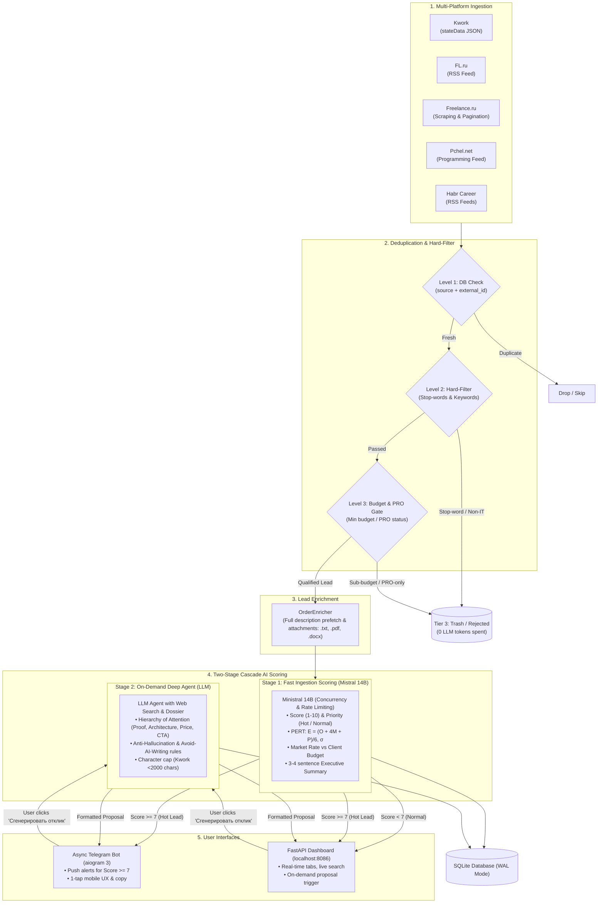

# Freelance Leads Monitor

[English](README.md) · [Русский](README.ru.md)

[](https://www.python.org/downloads/)
[](https://fastapi.tiangolo.com/)
[](https://docs.aiogram.dev/)
[](https://www.sqlite.org/wal.html)
[](https://www.docker.com/)

An autonomous, multi-platform freelance lead intelligence and evaluation system. It continuously monitors 5 Russian-speaking freelance exchanges, filters out irrelevant projects via a three-level deterministic pipeline, evaluates viable orders using a two-stage cascaded LLM architecture, calculates realistic timelines using the PERT methodology, and delivers actionable leads instantly to a Telegram bot with 1-tap mobile UX and a real-time FastAPI web dashboard.

```bash
$ python -m src.main --once
2026-10-26 23:59:00 [INFO] Ingestion started across 5 platforms...
2026-10-26 23:59:02 [INFO] Collected: Kwork (14), FL.ru (22), Freelance.ru (18), Pchel.net (12), Habr Career (8)
2026-10-26 23:59:03 [INFO] HardFilter: 71 rejected (diplomas, 1C, low budget), 3 passed to LLM
2026-10-26 23:59:05 [INFO] Mistral: Evaluated 3 leads (1 Hot, 2 Normal). PERT & market price calculated.
2026-10-26 23:59:06 [INFO] Telegram: Delivered 1 Hot lead to @your_handle with action keyboard.
2026-10-26 23:59:06 [INFO] Pipeline complete. New leads persisted in SQLite WAL.
```

---

## Key Highlights

- **Autonomous Multi-Platform Ingestion:** Asynchronous scraping and RSS polling across 5 freelance exchanges: **Kwork** (client-side state hydration parser), **FL.ru** (RSS feed), **Freelance.ru** (category scraping & pagination), **Pchel.net** (programming feed with USD-to-RUB conversion), and **Habr Career** (RSS queries).
- **Three-Level Deduplication & Hard-Filtering:**
  1. *Database level:* Unique composite key constraint `(source, external_id)` in SQLite.
  2. *Heuristic stop-words filter:* Rejects low-value academic tasks (diplomas, coursework), non-target ecosystems (1C, Tilda, WordPress, simple layout), and marketing noise (SEO, SMM, fake reviews) with 0 token spend.
  3. *Budget & PRO gate:* Enforces minimum project budget (10 000 ₽, with Quick Wins micro-task bypass) and filters out PRO-locked projects when responding without paid subscriptions.
- **Two-Stage Cascade AI Scoring:**
  - *Stage 1 (Ingestion Scoring via Mistral 14B):* Concurrency-governed (semaphore + rate limiting) evaluation producing a fit score (1–10), 3–4 sentence executive summary, market rate estimation, and technical risk breakdown.
  - *Stage 2 (On-Demand Deep Agent via LLM):* Triggered only when the user chooses to apply. Employs web search, project dossier matching, and the **Hierarchy of Attention** (anti-spam proof -> architecture -> firm price -> low-friction CTA) under strict anti-hallucination and avoid-AI-writing constraints.
- **Mathematical PERT Estimation:** Calculates expected duration and variance based on Three-Point Estimates:
  $$E = \frac{O + 4M + P}{6}, \quad \sigma = \frac{P - O}{6}$$
- **1-Tap Mobile UX (aiogram 3):** Hot leads ($\ge 7/10$) delivered instantly via Telegram bot with rich HTML cards and inline action buttons (generate proposal, copy-ready quote block, open listing, archive).
- **FastAPI Web Dashboard:** Clean Tailwind CSS dashboard running at `http://localhost:8086` featuring multi-tab views (Hot, All, Normal, Trash, Analytics, Settings, Config), live client-side search, PRO toggle, and basic authentication.

---

## Data Pipeline Architecture



---

## Supported Exchanges & Extraction Details

| Exchange | Extraction Method | Rate Limits & Ingestion Strategy | PRO / Free Filter |
|---|---|---|---|
| **Kwork** | Server-rendered `window.stateData` JSON (IT & Bots categories) | 180s polling, browser headers, pagination up to 5 pages | Free responses |
| **FL.ru** | Official RSS feed (`/rss/all.xml`) | Standard XML polling, description cleanup | Filtered via `(для всех)` in title |
| **Freelance.ru** | IT (`c[]=4`), AI (`c[]=724`), query search | 180s polling, desktop User-Agent, Cold Start backfill (4 pages) | Detected via `task-card__pro` badge |
| **Pchel.net** | Programming feed (`/jobs/programming/`) | Pagination (1–3 pages), automated USD-to-RUB conversion (95.0) | Open IT tasks |
| **Habr Career** | RSS feeds by query (`python`, `ai`, `backend`) | Standard RSS polling, skill enrichment | Direct employer postings |

---

## Core Engineering Components

### 1. Three-Level Filtering & Deduplication
- **Zero-Token Rejection:** Over 90% of incoming jobs are rejected before reaching any LLM endpoint, preventing unnecessary API costs and token usage.
- **Attachment Enrichment:** For passed leads, `OrderEnricher` downloads and extracts text from attached specifications, text files, and `.pdf`/`.docx` documents directly into the analysis payload.

### 2. Two-Stage Cascade AI Scoring
- **Mistral Ingestion Classifier:** Operates under strict rate limiting (30 RPM) and concurrency controls (`asyncio.Semaphore`). Evaluates project complexity, identifies potential API limits, calculates realistic developer hours, and computes PERT metrics without generating proposal copy.
- **LLM Agent On-Demand Generation:** Generates bespoke proposals only when triggered by the user. Structured according to the 4-level **Hierarchy of Attention**:
  1. *Qualification Filter & Anti-Spam:* Answers test questions or highlights matching dossier case in the opening sentence.
  2. *Engineering Solution & Architecture:* Outlines modular architecture, APIs, rate limiting, and failure isolation.
  3. *Firm Pricing & Timeline:* Quotes recommended price and PERT timeline firmly without self-sabotaging discounts.
  4. *Low-Friction Call to Action (CTA):* Proposes a 10-minute discovery call or chat demo.
  - *Avoid-AI-Writing Rules:* No synthetic sycophancy ("I would be delighted"), no corporate cliches ("seamless", "robust"), no em-dashes (plain hyphens only), strict length restriction for Kwork (<2000 chars).

### 3. Telegram Bot (`aiogram 3`)
- **Instant Hot Alerts:** Leads scoring $\ge 7/10$ trigger immediate alerts.
- **1-Tap Mobile Copying:** Generated proposals are formatted in quote blocks for quick copying from a mobile device without awkward text selection.
- **Interactive Controls:** Inline buttons to trigger proposal generation, view project URL, and move orders to archive.

### 4. Web Dashboard (`FastAPI`)
- **Multi-Tab Interface:** Hot Leads, All Passed, Normal, Trash, Analytics, Settings, and YAML Config Editor.
- **Client-Side Live Filtering:** Real-time search across titles, descriptions, and technology stacks without page reload.
- **Security:** HTTP Basic Authentication protecting dashboard views and REST APIs.

---

## Configuration

Configuration is cleanly partitioned between credentials (`.env`) and system parameters ([`config.yml`](config.yml)).

### 1. Credentials (`.env`)

```bash
cp .env.example .env
```

```env
# Telegram Bot Configuration
BOT_TOKEN=123456789:ABCdefGHIjklMNOpqrsTUVwxyz
ADMIN_CHAT_ID=123456789

# LLM Provider API Key (Mistral)
MISTRAL_API_KEY=your_mistral_api_key_here

# Web Dashboard Basic Auth
WEB_AUTH_ENABLED=true
WEB_AUTH_USERNAME=admin
WEB_AUTH_PASSWORD=change_me_secure_password
```

### 2. Application Parameters (`config.yml`)
- `storage.db_path`: Database path (`data/jobs.db`).
- `web.host` & `web.port`: Web server host and port (`0.0.0.0:8086`).
- `polling`: Intervals per collector (default 180s).
- `filter`: Minimum budget (10 000 ₽), hot lead threshold (7/10), stop-words list, keywords list.
- `llm`: Provider configuration, model selection (`ministral-14b-latest`), concurrency semaphores, and rate limits.
- `prompts`: Developer portfolio dossier, prompt rules, and system templates.

---

## Deployment & Quickstart

### Method A: Docker & Docker Compose (Recommended)

1. Clone repository and set up environment:
   ```bash
   git clone https://github.com/your_handle/freelance-leads-monitor.git
   cd freelance-leads-monitor
   cp .env.example .env
   # Edit .env with your BOT_TOKEN and credentials
   ```

2. Build and run via Docker Compose:
   ```bash
   docker compose up -d
   ```

3. Check logs and health:
   ```bash
   docker compose logs -f
   curl -u admin:change_me_secure_password http://localhost:8086/health
   ```

The web dashboard is accessible at `http://localhost:8086`.

---

### Method B: Virtual Environment (Manual)

#### Prerequisites
- Python 3.12+
- SQLite 3.35+ (with WAL mode)

#### Installation
```bash
git clone https://github.com/your_handle/freelance-leads-monitor.git
cd freelance-leads-monitor

python3 -m venv .venv
source .venv/bin/activate  # On Windows: .venv\Scripts\activate

pip install -e ".[dev]"
cp .env.example .env
# Edit .env with your credentials
```

#### Running the Test Suite
```bash
pytest -v
```

#### Single Ingestion Run
```bash
python -m src.main --once
```

#### Continuous Daemon (Scraper + Bot + Web UI)
```bash
python -m src.main
```

---

## Verification & Testing

The test suite covers:
- Collectors parsing and pagination (Kwork, FL.ru, Freelance.ru, Pchel.net, Habr Career, Avito).
- Heuristic filter rejection and keyword matching.
- Attachment text extraction (.pdf, .docx, plain text).
- PERT estimation and market rate calculations.
- Telegram bot command routing and keyboards.
- Web dashboard endpoints, authentication, and stats.

To run tests with `uv`:
```bash
uv run --extra dev pytest
```

---

## Metadata for Repository

- **Repository Description:** Autonomous freelance lead aggregator with 3-level deduplication, two-stage cascade AI scoring (Mistral + LLM agent), PERT estimation, aiogram 3 bot, and FastAPI dashboard.
- **Topics:** `python`, `aiogram`, `fastapi`, `llm`, `mistral`, `lead-generation`, `freelance-monitor`, `pert-estimation`, `web-scraping`, `sqlite-wal`, `prompt-engineering`, `telegram-bot`, `async-python`

---

## License

This project is licensed under the [PolyForm Noncommercial 1.0.0](LICENSE) License — free for personal, non-commercial, and research use.
