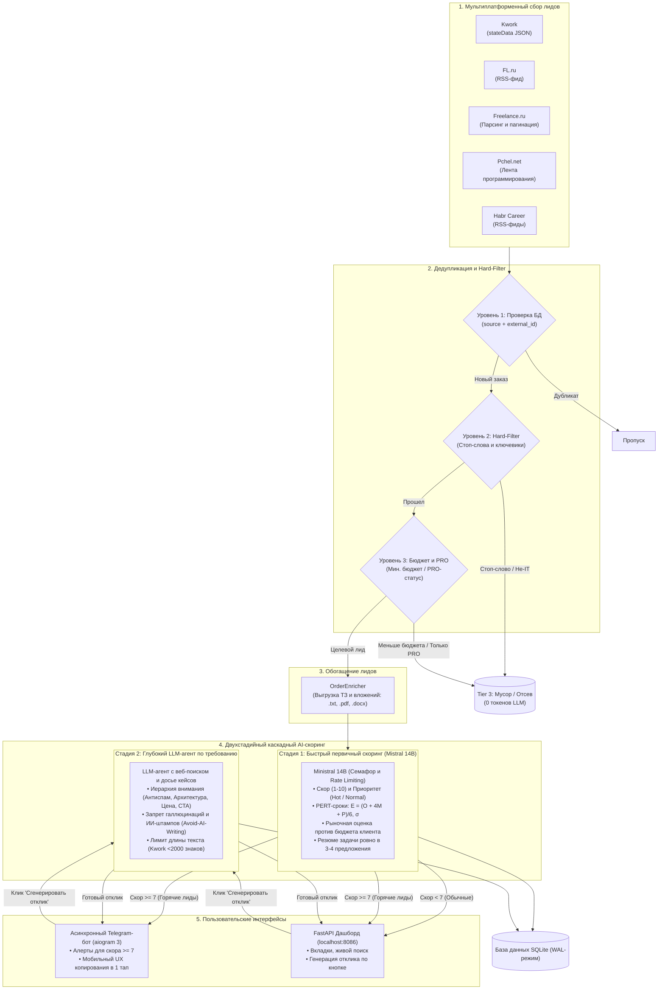

# Freelance Leads Monitor

[English](README.md) · [Русский](README.ru.md)

[](https://www.python.org/downloads/)
[](https://fastapi.tiangolo.com/)
[](https://docs.aiogram.dev/)
[](https://www.sqlite.org/wal.html)
[](https://www.docker.com/)

Автономный сервис агрегации, скоринга и оценки заказов с русскоязычных бирж фриланса. Выполняет непрерывный мониторинг 5 площадок, отсеивает нерелевантный трафик через трехуровневый детерминированный пайплайн, проводит двухстадийный каскадный AI-скоринг (быстрая классификация через Mistral + глубокая оценка и генерация откликов через LLM-агента), рассчитывает сроки по методике PERT и моментально доставляет качественные лиды в Telegram-бот с мобильным UX в 1 тап и на веб-дашборд FastAPI.

```bash
$ python -m src.main --once
2026-10-26 23:59:00 [INFO] Запущен цикл сбора по 5 площадкам...
2026-10-26 23:59:02 [INFO] Собрано: Kwork (14), FL.ru (22), Freelance.ru (18), Pchel.net (12), Habr Career (8)
2026-10-26 23:59:03 [INFO] HardFilter: 71 отсеяно (дипломы, 1С, низкий бюджет), 3 передано в LLM
2026-10-26 23:59:05 [INFO] Mistral: Оценено 3 заказа (1 Hot, 2 Normal). Рассчитаны PERT и рыночная цена.
2026-10-26 23:59:06 [INFO] Telegram: Доставлен 1 Hot-лид для @your_handle с интерактивными кнопками.
2026-10-26 23:59:06 [INFO] Цикл завершен. Новые лиды сохранены в SQLite WAL.
```

---

## Ключевые возможности

- **Автономный мультиплатформенный сбор (5 бирж):** Асинхронный парсинг и опрос RSS-лент на площадках: **Kwork** (парсинг серверного JSON гидратации `window.stateData`), **FL.ru** (RSS-фид), **Freelance.ru** (парсинг категорий с пагинацией), **Pchel.net** (лента программирования с конвертацией USD -> RUB), **Habr Career** (RSS-фиды по запросам).
- **Трехуровневая дедупликация и жесткая фильтрация (Hard-Filter):**
  1. *Уровень базы данных:* Составной уникальный индекс `(source, external_id)` в SQLite исключает повторный сбор.
  2. *Эвристический фильтр стоп-слов:* Мгновенно отсекает студенческие работы (дипломы, курсовые), нецелевые платформы (1C, Tilda, WordPress, верстка) и маркетинговый шум (SEO, SMM, накрутка отзывов) без расхода токенов LLM.
  3. *Бюджетный и PRO-фильтр:* Проверка минимального бюджета (10 000 ₽ с пропуском микро-задач Quick Wins) и фильтрация PRO-заказов для возможности отклика без платных подписок бирж.
- **Двухстадийный каскадный AI-скоринг:**
  - *Стадия 1 (Первичный анализ через Mistral 14B):* Контроль нагрузки (семафор конкурентности + rate limiting 30 RPM), оценка привлекательности (скор 1–10), выжимка ТЗ в 3–4 предложения, объективная рыночная оценка и выявление технических рисков.
  - *Стадия 2 (Глубокий LLM-агент по требованию):* Запускается только при явном клике пользователя. Включает веб-поиск по биржам, привязку к релевантным кейсам из досье и составление отклика по **Иерархии внимания** (антиспам-ответ -> архитектура решения -> твердая цена -> низкопороговый CTA) по строгим правилам Avoid-AI-Writing.
- **Расчет сроков по методике PERT:** Трехточечная вероятностная оценка длительности проекта:
  $$E = \frac{O + 4M + P}{6}, \quad \sigma = \frac{P - O}{6}$$
- **Мобильный UX в 1 тап (`aiogram 3`):** Мгновенная доставка горячих лидов ($\ge 7/10$) с интерактивными кнопками генерации отклика, цитатным блоком для быстрого копирования с телефона, ссылкой на биржу и архивацией.
- **Веб-дашборд на FastAPI:** Интерактивный интерфейс на Tailwind CSS по адресу `http://localhost:8086`: раздельные вкладки (Горячие, Все, Обычные, Отсеянные, Аналитика, Настройки, Конфиг), живой поиск на клиенте без перезагрузки, тумблер PRO и Basic Auth защита.

---

## Архитектура и поток данных



---

## Поддерживаемые площадки

| Биржа | Метод сбора | Лимиты и стратегия опроса | Фильтрация PRO / Бесплатные |
|---|---|---|---|
| **Kwork** | Серверный JSON `window.stateData` (IT и боты) | Опрос раз в 180с, заголовки браузера, пагинация до 5 страниц | Только бесплатные отклики |
| **FL.ru** | Официальный RSS-фид (`/rss/all.xml`) | Стандартный XML polling, очистка HTML | Разделение по `(для всех)` в заголовке |
| **Freelance.ru** | IT (`c[]=4`), AI (`c[]=724`), лента поиска | 180с опрос, десктопный User-Agent, бэкфилл 4 страниц при старте | Определение плашки `task-card__pro` |
| **Pchel.net** | Раздел Программирование (`/jobs/programming/`) | Пагинация (1–3 страницы), конвертация USD -> RUB (95.0) | Открытые IT-проекты |
| **Habr Career** | RSS-фиды по запросам (`python`, `ai`, `backend`) | Стандартный RSS polling, обогащение навыками | Прямые вакансии работодателей |

---

## Архитектурные компоненты

### 1. Трехуровневая фильтрация и обогащение
- **Отсев с нулевыми затратами токенов:** Более 90% нерелевантного трафика бирж отсекается до вызова нейросетей, экономя бюджет API.
- **Обогатитель заказов (`OrderEnricher`):** Для лидов, прошедших Hard-Filter, скачивается полное ТЗ со страницы заказа, а также текстовые вложения и документы `.pdf`/`.docx`.

### 2. Двухстадийный каскадный AI-скоринг
- **Mistral-классификатор первичного сбора:** Работает с ограничением 30 RPM и семафором параллельности (`asyncio.Semaphore`). Определяет техническую сложность, риски (WAF, капчи, лимиты API), рассчитывает PERT-сроки и чистую рыночную ставку без генерации текста отклика.
- **Глубокий LLM-агент по требованию:** Вызывается только по кнопке пользователя. Строит отклик по 4-уровневой **Иерархии внимания**:
  1. *Квалификационный фильтр и антиспам:* Прямой ответ на вопросы заказчика или кодовое слово в первой строке.
  2. *Инженерное решение и архитектура:* Описание модулей, API, обработки ошибок (retry/backoff) и стека.
  3. *Твердая стоимость и сроки:* Указание рекомендуемой цены без демпинга и самоскидок.
  4. *Низкопороговый призыв к действию (CTA):* Предложение 10-минутного звонка или демонстрации примеров в чате.
  - *Правила Avoid-AI-Writing:* Запрет шаблонных восторгов («буду рад сотрудничеству»), канцелярита («бесшовно», «робастный»), длинных тире (строго дефисы «-») и жесткий лимит для Kwork (<2000 знаков).

### 3. Telegram-бот (`aiogram 3`)
- **Мгновенные алерты:** Автоматическая отправка карточки лида при скоре $\ge 7/10$.
- **Мобильный UX копирования:** Текст отклика оборачивается в блок цитаты для копирования в один тап с телефона.
- **Интерактивные кнопки:** Вызов генерации отклика, открытие ссылки на заказ, архивация.

### 4. Веб-дашборд (`FastAPI`)
- **Вкладки:** Горячие лиды, Все прошедшие, Потенциальные, Отсеянные, Аналитика рынка, Настройки и редактор `config.yml`.
- **Живой клиентский поиск:** Фильтрация по заголовку, технологиям и сути задачи без перезагрузки страниц.
- **Безопасность:** Защита HTTP Basic Auth для всех эндпоинтов и API.

---

## Конфигурация

Конфигурация разделена на секреты (`.env`) и системные параметры ([`config.yml`](config.yml)).

### 1. Секреты и ключи (`.env`)

```bash
cp .env.example .env
```

```env
# Токен Telegram-бота
BOT_TOKEN=123456789:ABCdefGHIjklMNOpqrsTUVwxyz
ADMIN_CHAT_ID=123456789

# Ключ API Mistral
MISTRAL_API_KEY=your_mistral_api_key_here

# Авторизация в веб-дашборде
WEB_AUTH_ENABLED=true
WEB_AUTH_USERNAME=admin
WEB_AUTH_PASSWORD=change_me_secure_password
```

### 2. Параметры системы (`config.yml`)
- `storage.db_path`: Путь к базе SQLite (`data/jobs.db`).
- `web.host` и `web.port`: Биндинг сервера (`0.0.0.0:8086`).
- `polling`: Интервалы опроса сборщиков (по умолчанию 180с).
- `filter`: Минимальный бюджет (10 000 ₽), порог горячих лидов (7/10), списки стоп-слов и ключевиков.
- `llm`: Выбор модели (`ministral-14b-latest`), семафоры конкурентности, лимиты RPM.
- `prompts`: Досье проектов разработчика, правила типографики и шаблоны промптов.

---

## Развертывание и быстрый старт

### Способ 1: Docker & Docker Compose (Рекомендуемый)

1. Клонируйте репозиторий и настройте переменные окружения:
   ```bash
   git clone https://github.com/your_handle/freelance-leads-monitor.git
   cd freelance-leads-monitor
   cp .env.example .env
   # Укажите BOT_TOKEN и другие учетные данные в .env
   ```

2. Соберите и запустите контейнеры:
   ```bash
   docker compose up -d
   ```

3. Проверьте логи и доступность:
   ```bash
   docker compose logs -f
   curl -u admin:change_me_secure_password http://localhost:8086/health
   ```

Веб-дашборд доступен в браузере по адресу: `http://localhost:8086`.

---

### Способ 2: Виртуальное окружение Python (Ручной)

#### Требования
- Python 3.12+
- SQLite 3.35+ (с поддержкой WAL-режима)

#### Установка
```bash
git clone https://github.com/your_handle/freelance-leads-monitor.git
cd freelance-leads-monitor

python3 -m venv .venv
source .venv/bin/activate  # На Windows: .venv\Scripts\activate

pip install -e ".[dev]"
cp .env.example .env
# Заполните учетные данные в .env
```

#### Запуск тестов
```bash
pytest -v
```

#### Разовый цикл сбора (`--once`)
```bash
python -m src.main --once
```

#### Непрерывный сервис (Сборщики + Бот + Веб-интерфейс)
```bash
python -m src.main
```

---

## Тестирование и верификация

Набор тестов проверяет:
- Корректность парсинга и пагинации сборщиков (Kwork, FL.ru, Freelance.ru, Pchel.net, Habr Career, Avito).
- Работу Hard-Filter и отсева по стоп-словам.
- Извлечение текста из документов (.pdf, .docx, txt).
- Математический расчет PERT-сроков и рыночной стоимости.
- Роутинг команд и клавиатур Telegram-бота.
- Эндпоинты, авторизацию и аналитику веб-дашборда.

Запуск тестов через `uv`:
```bash
uv run --extra dev pytest
```

---

## Метаданные репозитория

- **Описание (description):** Autonomous freelance lead aggregator with 3-level deduplication, two-stage cascade AI scoring (Mistral + LLM agent), PERT estimation, aiogram 3 bot, and FastAPI dashboard.
- **Темы (topics):** `python`, `aiogram`, `fastapi`, `llm`, `mistral`, `lead-generation`, `freelance-monitor`, `pert-estimation`, `web-scraping`, `sqlite-wal`, `prompt-engineering`, `telegram-bot`, `async-python`

---

## Лицензия

Проект распространяется под лицензией [PolyForm Noncommercial 1.0.0](LICENSE) — бесплатно для личного, некоммерческого и исследовательского использования.
